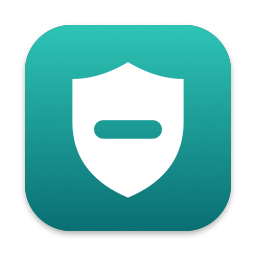
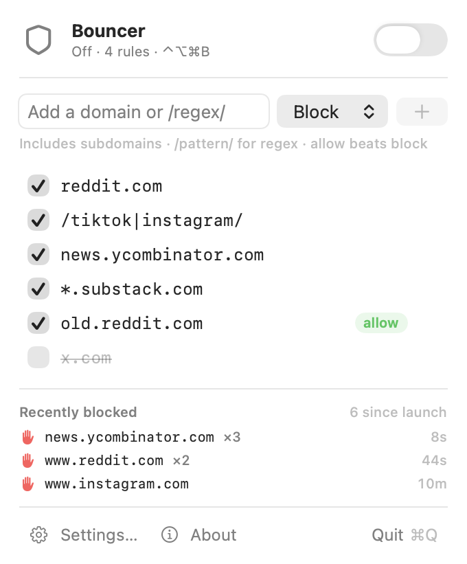

# Bouncer

<p align="center">
  
</p>

Bouncer is a native macOS menu bar app that blocks the sites you don't want to
visit — in every browser and app, including with iCloud Private Relay on. Rules
are plain domains or regular expressions, blocking toggles from the menu bar, a
global hotkey, or the bundled `bouncer` command-line tool, and **quitting Bouncer
always removes every block**.

<p align="center">
  
</p>

## Features

- Block by domain (`reddit.com` covers every subdomain), subdomains only
  (`*.example.com`), or case-insensitive regex (`/tiktok|instagram/`).
- Allow rules override block rules, so `/.*/` plus a few allow rules is an
  allowlist-only mode.
- A switch in the menu bar panel, Option-click on the icon, or a system-wide
  hotkey (⌃⌥⌘B by default) toggles blocking — no Accessibility permission needed.
- The menu bar icon briefly flashes the domain whenever Bouncer turns a lookup away,
  and the panel lists recently blocked domains.
- Works in Safari, Chromium browsers, Firefox, and every other app, with or
  without iCloud Private Relay. A built-in self-test warns if something bypasses it.
- A `bouncer` CLI with `--json` output that can do everything the UI does.
- Plain-text settings in `~/.config/bouncer/config.toml`.
- No administrator password, no root daemon, no analytics. Bouncer's only network
  traffic is forwarding your allowed DNS lookups to your normal resolvers.

## Install (build from source)

Bouncer blocks through a Network Extension packet tunnel. macOS only runs that kind
of extension when it's signed with a provisioning profile, so there is no
notarized download; build it under your own Apple developer team instead.

Requirements: macOS 14 or later, Xcode 26, [mise](https://mise.jdx.dev), and an
Apple Developer Program membership (for the Network Extension capability).

```sh
git clone https://github.com/danielcorin/Bouncer.git && cd Bouncer
mise install
cp Configuration/Local.xcconfig.example Configuration/Local.xcconfig
# Edit Local.xcconfig: set DEVELOPMENT_TEAM to your Team ID and
# PRODUCT_BUNDLE_IDENTIFIER to an ID you own (the tunnel becomes <ID>.Tunnel).
scripts/try-dev.sh   # builds, provisions, installs to /Applications, and launches
```

The first time you turn blocking on, macOS asks you to allow Bouncer's VPN
configuration; after that, toggling never prompts.

## Using it

- **Menu bar**: click the shield to open the menu: the blocking switch, add/remove
  rules, and recently blocked domains. Option-click the shield to toggle blocking
  directly. Double-click a rule to edit it; right-click for more.
- **Hotkey**: ⌃⌥⌘B toggles blocking from anywhere (change it in Settings, or
  `bouncer config set hotkey --value "shift+cmd+f12"`).
- **About**: the ⓘ button in the menu (or Settings › About) shows the version, how
  blocking works, and the shortcuts.
- **Indicator**: when a lookup is blocked, the menu bar icon turns into a red hand
  and shows the blocked domain for a couple of seconds.

### Rules

| You type | Kind | Matches |
| --- | --- | --- |
| `reddit.com` | domain | `reddit.com` and every subdomain (`old.reddit.com`, …) |
| `*.reddit.com` | domain | subdomains only |
| `https://www.reddit.com/r/x` | domain | reduced to `www.reddit.com` |
| `/news\|tiktok/` | regex | any domain containing `news` or `tiktok` |
| `/^x\.com$/` | regex | exactly `x.com` |

Regexes are case-insensitive and unanchored, tested against the full lowercase
domain (no scheme, path, or trailing dot). **Allow rules beat block rules**, so
`/.*/` (block) plus a few allow rules is an allowlist-only mode.

### CLI

Install it from **Settings → Command line** (symlinks `~/.local/bin/bouncer`).
If the app isn't running, the CLI launches it.

```sh
bouncer on | off | toggle            # blocking (first `on` asks you to allow the VPN configuration)
bouncer status                       # phase, verification, rule count, tunnel state, hotkey
bouncer rules add reddit.com
bouncer rules add '/(^|\.)tiktok\.com$/'
bouncer rules add old.reddit.com --action allow
bouncer rules list
bouncer rules update old.reddit.com --enabled false   # ID, ID prefix, or exact pattern
bouncer rules remove 71BE9CD1
bouncer test www.reddit.com          # which rule (if any) applies
bouncer activity --limit 10          # recently blocked domains
bouncer browser restart --force      # quit and relaunch the default browser (tabs restored for Chromium)
bouncer tunnel install | tunnel remove --force
bouncer config list --all true       # settings live in ~/.config/bouncer/config.toml
bouncer quit                         # removes blocks
```

Every command accepts `--json`. Results go to stdout, errors to stderr as
`{error:{code,message}}`; exit codes are 0 success, 1 operation failure,
2 invalid invocation, 3 app unavailable.

### Settings (`config.toml`)

| Key | Default | Meaning |
| --- | --- | --- |
| `hotkey` | `ctrl+option+cmd+b` | Global toggle; empty disables it |
| `enable-on-launch` | `false` | Turn blocking on at launch |
| `flash-indicator` | `true` | Flash the menu bar on each block |
| `block-bypass-canaries` | `true` | While blocking, tell Firefox's DNS-over-HTTPS to use system DNS |
| `upstream-dns` | *(empty)* | Comma-separated resolvers; empty follows the network's DHCP/RA servers |
| `restart-browser` | `ask` | After blocking turns on or a block rule is added, restart the default browser: `ask`, `always`, or `off` |

## How it works

Domain matching (especially regex) can't be done with `/etc/hosts`, and simply
changing the Mac's DNS server is bypassed by iCloud Private Relay, which encrypts
every app's DNS. So Bouncer filters DNS inside a Network Extension:

1. Turning blocking on starts **Bouncer's packet tunnel** (`Sources/Tunnel`), which
   appears as "Bouncer" in System Settings › VPN. It claims a single route — a
   virtual resolver at `198.18.0.1` — and registers it as the DNS server for every
   domain. All other traffic keeps using the normal network.
2. macOS gives a VPN's DNS settings priority over Private Relay's encrypted DNS, so
   every resolver lookup reaches the tunnel whether or not Private Relay is on
   (Private Relay itself stays connected). Chromium-based browsers' built-in DNS
   clients also follow the system DNS configuration to the tunnel.
3. Blocked names get NXDOMAIN with a zero TTL; everything else is relayed unchanged
   to the network's real resolvers (re-detected every few seconds, so switching
   networks works). Truncated answers are re-fetched over TCP.
4. After turning on, Bouncer resolves a self-test name only the tunnel knows; the
   menu shows **Bypassed** and `bouncer status` reports `BYPASSED` if it doesn't
   come back.
5. Blocks never outlive the app: quitting stops the tunnel, and the app sends the
   tunnel a heartbeat every half second — if it stops (crash, force quit), the
   tunnel shuts itself down within about 12 seconds.

### Limits

- Browsers keep using connections they already have open (especially HTTP/3), so a
  site you just blocked can keep loading without a new DNS lookup. When blocking
  turns on or you add a block rule, Bouncer asks to restart your default browser
  (`restart-browser`). Chromium browsers relaunch with their windows and tabs;
  Safari and Firefox reopen them according to their own settings. Other browsers
  and apps need a manual restart.
- macOS runs one VPN at a time. Starting another VPN disconnects Bouncer's tunnel;
  Bouncer then reports that blocking stopped rather than fighting it.
- Tested with iCloud Private Relay on: Safari, a Chromium-based browser, curl, and
  the system resolver all resolve through the tunnel and are blocked.
- Browsers with a hard-coded DNS-over-HTTPS provider (Chrome/Edge "Secure DNS" set
  to a specific provider, Firefox "Max Protection") bypass system DNS.
- The tunnel is an app extension, which macOS runs only with development or App
  Store signing, so each user builds Bouncer under their own team. A notarized
  download would mean moving it to a Developer ID system extension (with a
  one-time approval in System Settings).
- Tunnel logs: `log show --last 10m --predicate 'subsystem == "llc.wvlen.Bouncer.Tunnel"'`.

## Development

```sh
mise install
scripts/generate-api.sh      # after editing API/openapi.yaml
scripts/verify.sh            # the full gate: generation, boundaries, tests, scenarios
scripts/try-dev.sh           # development-signed build (provisions the tunnel) → /Applications
BOUNCER_SNAPSHOT_DIR=$(mktemp -d) build/Build/Products/Debug/Bouncer.app/Contents/MacOS/Bouncer
                             # Debug only: render the menu, Settings, About (light + dark) to PNGs
swift scripts/generate-app-icon.swift  # re-render the icon (AppIcon.icon glyph + legacy PNGs); colors live at the top
```

`project.yml` is the Xcode source of truth; set `DEVELOPMENT_TEAM` and
`PRODUCT_BUNDLE_IDENTIFIER` in the ignored `Configuration/Local.xcconfig`. Pull
requests run `scripts/verify.sh` in CI. Targets:

- `Sources/Filter` — rule matching, DNS packets, the filter engine, tunnel wire protocol (app + tunnel)
- `Sources/Tunnel` — the packet tunnel extension: virtual resolver, forwarding, heartbeat watchdog
- `Sources/Core` — `BlockingStore`, `BouncerService` (every operation), `TunnelFilterBackend`, TOML settings
- `Sources/App` — status item, menu bar panel, Settings and About windows, Carbon hotkey
- `Sources/CLI` — generated commands plus renderers in `Custom/`

Follow [docs/interface-consistency.md](docs/interface-consistency.md) when adding a
feature: contract in `API/openapi.yaml`, implementation in `BouncerService`, a
scenario in `TestsSupport/AppScenarios.swift`, UI calling the same service.

## License

Bouncer is available under the [Apache License 2.0](LICENSE). Third-party
components are listed in [THIRD_PARTY_NOTICES.md](THIRD_PARTY_NOTICES.md).
